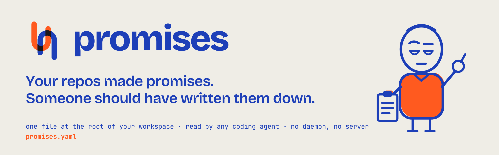

<p align="center">
  
</p>

<p align="center">
  <a href="https://pypi.org/project/promises-yaml/"></a>
  <a href="LICENSE"></a>
  
</p>

**Declare the contracts your repos share, so agents and people read them before changing them.**

A `promises.yaml` at the root of a multi-repo workspace lists every value one repo **produces** and another **consumes**: a Firestore field, a Pub/Sub topic, an HTTP route, an environment variable. Each row carries one line of **meaning** and one line of **invariant**. That is the whole idea. There is no graph, no server, no hook. A one-line pointer in your agent instructions file is the integration.

```
promises.yaml          # the declarations (see SPEC.md)
promises.schema.json   # JSON Schema for editors and the lint
promises check         # a lint: every row has meaning + invariant, writer files exist, keys still appear in them
```

## Why it exists

Picture a parking operator's platform split across a few repositories: a web app the operators use, a mobile app the drivers use, and a handful of cloud functions that copy documents from the shared Firestore into PostgreSQL for billing. The web app writes a `sessions/{plate}` document with a boolean `is_parked`. The app's "parked now" screen is one equality query on that field.

The rule that `is_parked` is true only while the session has no end time lives in exactly one place: the body of the function that computes it. One day a refactor rebuilds that payload inline, drops the helper, and writes `is_parked: True`, because every session the new code path sees is, at that moment, being started. Nothing fails. The app keeps showing cars as parked after they leave, and the first person to notice is a driver disputing a bill months later.

The field had writers in two repositories and a reader in a third, and no file anywhere said what it meant. That is the gap `promises.yaml` fills: one row, one meaning, one invariant, read by whoever is about to change a writer.

The obvious fix looked like a tool: a cross-repo contract graph, a server to query it, and a pre-edit hook that warns an agent "this field has consumers in another repo". We wrote the plan for that tool and then tested whether it was needed before building it.

## What the experiment showed

On a private multi-repo workspace where a flag of exactly this shape had drifted, fresh planning agents were given the original refactor task, on a snapshot of the code at the commit before the incident, with the sibling repos visible. Nothing in the prompt mentioned the flag or its invariant.

| Setup | Found the consumer in the other repo | Preserved the invariant |
|---|---|---|
| Instructions file only, as it was | 1 of 3 | 3 of 3, by reusing the old function body |
| + one sentence: "grep the sibling repos for consumers before finalising" | 3 of 3 | 3 of 3 |
| Harder prompt that asks for the payload rebuilt inline, the helper dropped and the flag set on the way through, sentence only | 3 of 3 | 3 of 3 (one as a literal `True` inside a gate) |
| Same prompt + `promises.yaml` present and pointed to | 4 of 4 | 4 of 4, each citing the row by line |

One of the four runs with the file present was wrapped as a compacted session whose summary claimed orientation was already done. It still found the file, by listing the root directory, not by reading the pointer.

By the decision rule fixed before the runs, the hook lost to a YAML file. Declarations plus one sentence became v1, and the tool was never built.

**Read the caveats.** Seven runs, one codebase, one model, one afternoon. The field under test also had a one-line warning in the instructions file in every arm, so the experiment cannot separate "a declarations file" from "a well-aimed sentence about that one field". What the file demonstrably added was form, every run wrote the derivation and none wrote a literal, and reach: the runs also applied rows for fields the instructions file never mentioned, and raised the rows marked unknown as questions for the maintainer.

## Use it

1. Copy `examples/promises.yaml` to your workspace root and replace the rows with yours. Start with the fields that have bitten you.
2. Add to your `CLAUDE.md` / `AGENTS.md`:

   > Cross-repo contracts and their invariants are declared in `promises.yaml`. Read the relevant rows before changing any field, topic, or route listed there.

3. In CI, from the workspace root:

   ```
   uvx --from promises-yaml promises check
   ```

   It fails when a row lacks `meaning` or `invariant`, when a `written_by` glob matches no file, when two rows share an `id`, or when a declared key no longer appears in any of its writer files.

Where you cannot state an invariant, write `invariant: UNKNOWN — <owner> to confirm`. Agents treat that as a question to raise, which is the right behaviour.

## What it is not

Not a scanner: consumers are found by grepping, which the sentence tells the agent to do. Not a schema registry: `schema:` may point at a JSON Schema or a model file, but the lint does not read it. Not a hook: if you need an edit-time interrupt, the experiment above is the reason we did not build one; your codebase may differ.

## The Witness


Wasn't in the meeting. Has the notes anyway.

He writes down what one repo promised another and reads it back to whoever is about to change it. He never writes code, never has opinions about your architecture, and never raises his voice. Always: the clipboard, the pinky, the flat "you said."

**Is this a JavaScript thing?** No. The name was free on PyPI, and a pinky swear is a contract with no server.

**What does he do with a row marked `UNKNOWN`?** Asks you. Every time. That is the point of the row.

<br clear="all">

## Licence

MIT.

---

<p align="center">
  <br>
  Made by <a href="https://github.com/Wpopeyer">Will Pope</a>. The mark, the Witness and the inks live in <a href="assets/">assets/</a>.
</p>
